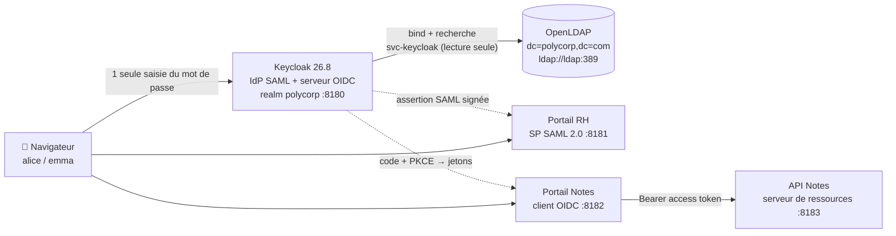
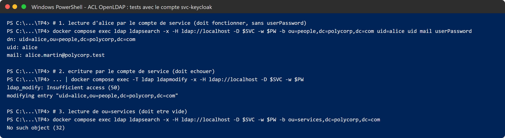
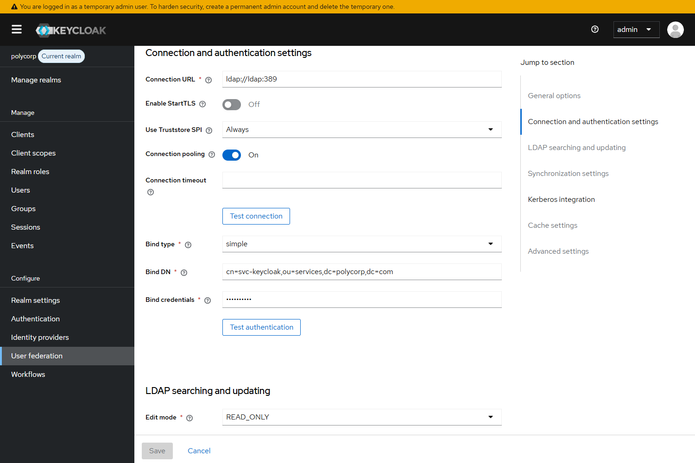
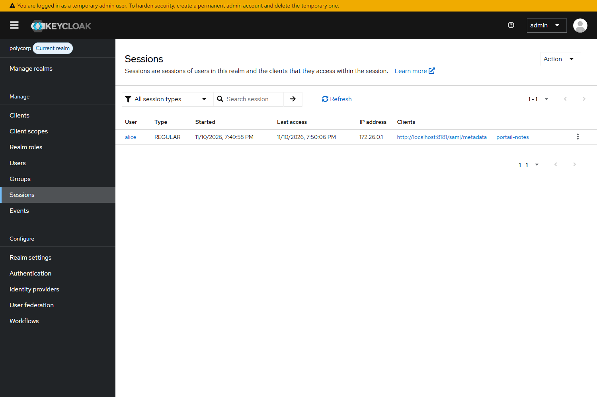
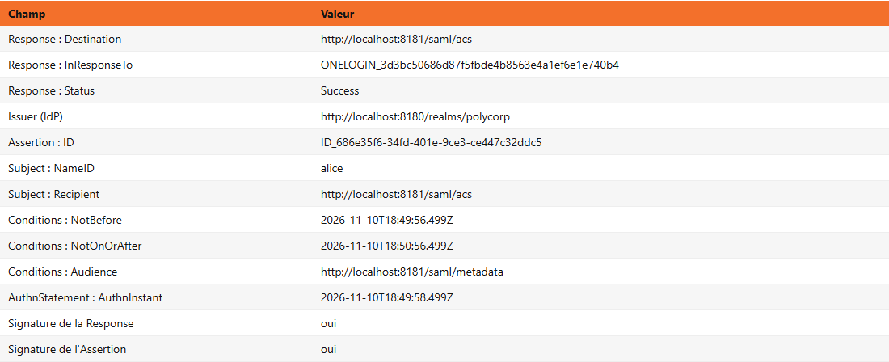
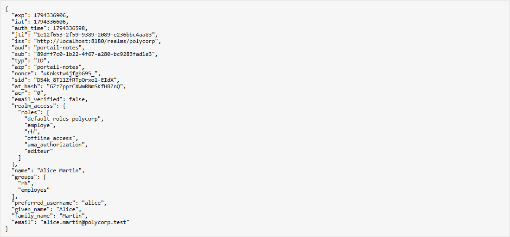
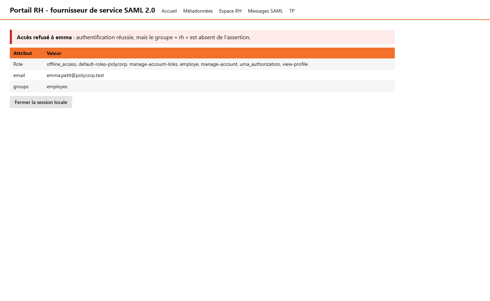
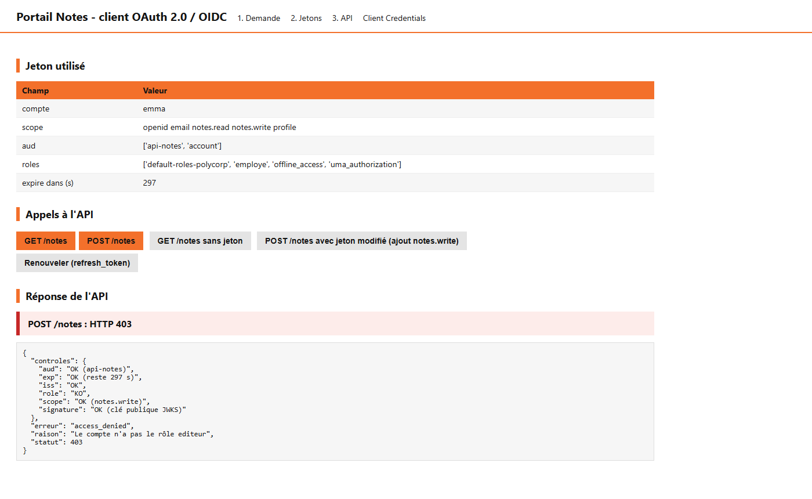
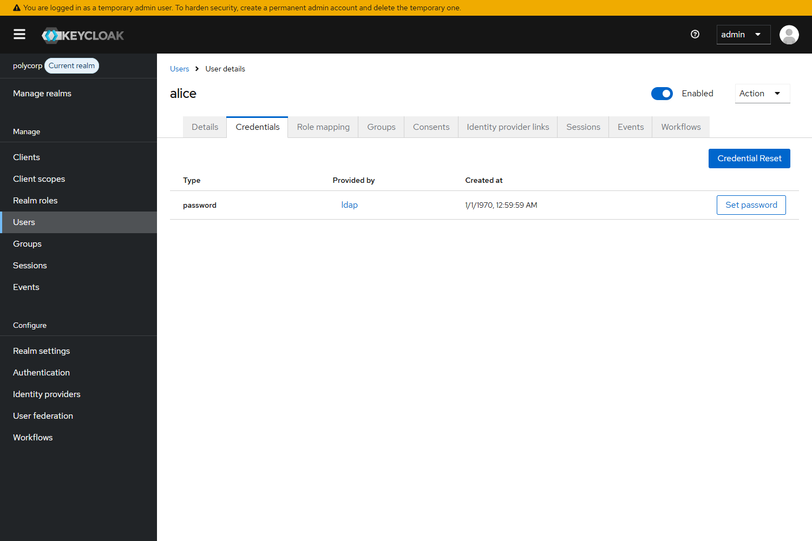
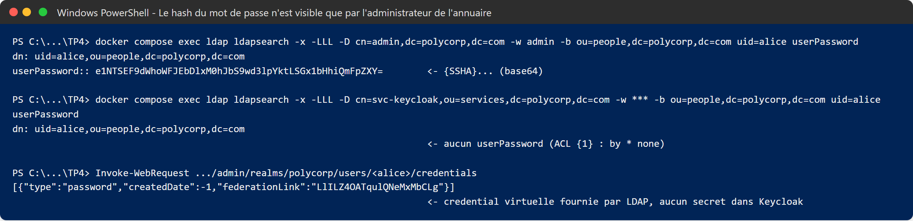

# Portail SSO adossé à un annuaire — Mini-projet IAM

> **Polycorp** possède déjà un annuaire OpenLDAP et veut ouvrir deux applications web **sans recréer ses comptes** :
> un **Portail RH en SAML 2.0** et un **Portail Notes en OpenID Connect**. Une seule saisie du mot de passe doit suffire pour les deux.


**Auteurs :** Ghassen Cheyah & Anas Abaza — Novembre 2026

📄 [Rapport complet (PDF)](rapport/Rapport_SSO_LDAP_Cheyah_Abaza.pdf) · 📊 [Présentation (PPTX)](rapport/Presentation_SSO_LDAP_Cheyah_Abaza.pptx)

---

## Sommaire

- [Objectifs](#objectifs)
- [Architecture](#architecture)
- [Structure du dépôt](#structure-du-dépôt)
- [Démarrage rapide](#démarrage-rapide)
- [Conception de l'annuaire](#conception-de-lannuaire)
- [Configuration de Keycloak](#configuration-de-keycloak)
- [Démonstrations et résultats](#démonstrations-et-résultats)
- [Sécurité](#sécurité)
- [Dépannage](#dépannage)
- [Limites et pistes d'amélioration](#limites-et-pistes-damélioration)

---

## Objectifs

| Travail demandé | Réalisation |
|---|---|
| Concevoir le DIT et les LDIF (unités, utilisateurs, groupes `rh` et `employes`) | 3 OU, 3 utilisateurs, 2 groupes, 1 compte de service, ACL dédiées |
| Connecter Keycloak à l'annuaire avec un compte de service limité, en lecture seule | Fédération LDAP `READ_ONLY`, bind `cn=svc-keycloak`, ACL testées |
| Faire correspondre attributs et groupes LDAP aux attributs SAML, claims OIDC et rôles | Mappers LDAP, groupes → rôles, mappers SAML et OIDC |
| Reprendre le Portail RH et le Portail Notes, réserver l'espace RH au groupe `rh` | SP SAML (8181), client OIDC (8182), API (8183), contrôle `GROUPE_RH` |

| À démontrer | Résultat |
|---|---|
| Alice ouvre les deux portails et ne saisit son mot de passe qu'une fois | ✅ 1 session Keycloak, 2 clients |
| Le même utilisateur apparaît dans l'assertion SAML et dans l'ID token | ✅ comparaison champ par champ |
| Emma est authentifiée mais refusée sur l'espace RH faute de groupe | ✅ HTTP 403 sur `/rh` et sur `POST /notes` |
| Un changement de mot de passe ou de groupe dans LDAP se répercute : mesurer quand | ✅ 0,26 – 0,32 s sans cache, 51,97 s avec cache |
| Le mot de passe n'est stocké que dans l'annuaire | ✅ credential « Provided by ldap », hash visible par l'admin LDAP seulement |

---

## Architecture



| Service | Technologie | Port (127.0.0.1) | Rôle |
|---|---|---|---|
| `ldap` | osixia/openldap 1.5.0 | 1389 | Annuaire : comptes, groupes, mots de passe (hash SSHA) |
| `keycloak` | Keycloak 26.8.1 | 8180 | IdP SAML et serveur d'autorisation OIDC, realm `polycorp` |
| `sp-saml` | Flask + python3-saml | 8181 | **Portail RH**, fournisseur de service SAML |
| `client-oauth` | Flask + PyJWT | 8182 | **Portail Notes**, client OIDC public (Authorization Code + PKCE S256) |
| `api-notes` | Flask + PyJWT | 8183 | Serveur de ressources : vérifie signature, `iss`, `aud`, `exp`, scope et rôle |

L'annuaire reste **la seule source** des identités, des groupes et des mots de passe. Keycloak fédère, les portails font confiance à Keycloak.

---

## Structure du dépôt

```
.
├── TP4/
│   ├── docker-compose.yml          # les 5 services
│   ├── apps/                       # Portail RH, Portail Notes, API (Flask)
│   │   ├── sp_saml.py              # SP SAML + contrôle GROUPE_RH
│   │   ├── client_oauth.py         # client OIDC pédagogique (PKCE, jetons, API)
│   │   ├── api_notes.py            # API protégée (scope notes.read / notes.write + rôle editeur)
│   │   ├── commun.py, Dockerfile, requirements.txt
│   ├── ldap/
│   │   ├── ldif/01-structure.ldif  # DIT : OU, utilisateurs, groupes, compte de service
│   │   └── 02-acl.ldif             # ACL du compte de service
│   ├── keycloak/
│   │   └── realm-polycorp.json     # export du realm (clients, groupes, rôles, fédération LDAP)
│   └── scripts/                    # scripts PowerShell
│       ├── appliquer-acl.ps1
│       ├── tester-acl.ps1
│       └── mesurer.ps1             # mesure de propagation LDAP -> Keycloak
└── rapport/
    ├── Rapport_SSO_LDAP_Cheyah_Abaza.pdf
    ├── Presentation_SSO_LDAP_Cheyah_Abaza.pptx
    ├── captures/                   # 48 captures des portails, de Keycloak et des terminaux
    └── outils/                     # scripts qui régénèrent captures, PDF et PPTX
```

---

## Démarrage rapide

**Prérequis :** Docker Desktop (Compose v2), un navigateur, PowerShell (Windows) ou un shell équivalent.

```powershell
# 1. Démarrer la plateforme (toujours depuis le dossier TP4)
cd TP4
docker compose up -d --build

# 2. Appliquer puis tester les ACL de l'annuaire
.\scripts\appliquer-acl.ps1
.\scripts\tester-acl.ps1
```

**3. Configurer Keycloak** — ouvrir <http://localhost:8180/admin> (`admin` / `admin`) :

- **Create realm** → *Resource file* : `TP4/keycloak/realm-polycorp.json` (crée le realm `polycorp`, ses clients, groupes, rôles et la fédération LDAP).
- **User federation → ldap → Bind credentials** : ressaisir le mot de passe du compte de service (masqué dans l'export), puis **Test authentication** et **Sync all users**.

> ⚠️ Toujours vérifier en haut à gauche que le realm actif est **polycorp** (et non `master`) avant de créer quoi que ce soit.

**4. Établir la confiance SAML côté Portail RH** — télécharger
<http://localhost:8180/realms/polycorp/protocol/saml/descriptor> puis le charger sur <http://localhost:8181/config>.
Le SP garde ces métadonnées en mémoire : à refaire après chaque redémarrage du conteneur `sp-saml`.

**5. Utiliser les portails**

| URL | Usage |
|---|---|
| <http://localhost:8181/rh> | Portail RH (SAML) — espace réservé au groupe `rh` |
| <http://localhost:8181/messages> | AuthnRequest et assertion SAML décodées |
| <http://localhost:8182> | Portail Notes (OIDC) — Demande → Jetons → API |
| <http://localhost:8180/admin> | Console Keycloak → realm polycorp → Sessions |

### Comptes de test (laboratoire uniquement)

| Compte | Mot de passe | Groupes LDAP | Accès attendu |
|---|---|---|---|
| `alice` | `Polycorp-TP4!` | rh, employes | Espace RH ✅ · lecture ✅ et écriture ✅ des notes |
| `bob` | `Polycorp-TP4!` | employes | Espace RH ❌ · lecture des notes ✅ |
| `emma` | `Polycorp-TP4!` | employes | Espace RH ❌ · lecture ✅, écriture ❌ |

---

## Conception de l'annuaire

```
dc=polycorp,dc=com
├── ou=people                      (organizationalUnit)
│   ├── uid=alice   Alice Martin   (inetOrgPerson, userPassword {SSHA})
│   ├── uid=bob     Bob Durand     (inetOrgPerson)
│   └── uid=emma    Emma Petit     (inetOrgPerson)
├── ou=groups                      (organizationalUnit)
│   ├── cn=rh        member: alice                 (groupOfNames)
│   └── cn=employes  member: alice, bob, emma      (groupOfNames)
└── ou=services                    (organizationalUnit)
    └── cn=svc-keycloak            (organizationalRole + simpleSecurityObject)
```

Les **ACL** ([`02-acl.ldif`](TP4/ldap/02-acl.ldif)) limitent le compte de service :

| Règle | Effet |
|---|---|
| `{0}` | root local via `ldapi:///` (EXTERNAL) : `manage`, sinon `break` |
| `{1}` | `userPassword` : utilisable pour s'authentifier (`anonymous auth`), illisible pour tous |
| `{2}` `{3}` | `svc-keycloak` lit `ou=people` et `ou=groups`, rien d'autre |
| `{4}` | refus par défaut |



---

## Configuration de Keycloak

### Fédération LDAP (User federation)

| Paramètre | Valeur |
|---|---|
| Connection URL | `ldap://ldap:389` |
| Bind DN | `cn=svc-keycloak,ou=services,dc=polycorp,dc=com` |
| Edit mode | **`READ_ONLY`** |
| Users DN / classe | `ou=people,dc=polycorp,dc=com` / `inetOrgPerson` |
| Username / RDN / UUID | `uid` / `uid` / `entryUUID` |
| Import users | On (le `sub` OIDC est donc un UUID Keycloak) |
| Mapper de groupes | `ou=groups`, `groupOfNames`, attribut `member` (DN), `READ_ONLY` |
| Cache policy | `NO_CACHE` (testé aussi en `MAX_LIFESPAN` 1 min) |



### Correspondances LDAP → Keycloak → SAML / OIDC

| LDAP | Keycloak | Assertion SAML (Portail RH) | Jetons OIDC (Portail Notes) |
|---|---|---|---|
| `uid` | username | `NameID` (format username) | `preferred_username` |
| `entryUUID` | lien LDAP ; ID Keycloak = UUID | – | `sub` |
| `mail` | email | attribut `email` | `email` |
| `givenName` / `sn` | firstName / lastName | – | `given_name`, `family_name`, `name` |
| `cn=rh` | groupe `rh` → rôles `rh`, `editeur` | `groups`, `Role` | `groups`, `realm_access.roles` |
| `cn=employes` | groupe `employes` → rôle `employe` | `groups`, `Role` | `groups`, `realm_access.roles` |

### Clients

- **SAML** `http://localhost:8181/saml/metadata` : réponse et assertion signées (RSA-SHA256), POST forcé vers `/saml/acs`, NameID *username*,
  scope `role_list` (attribut `Role`) et mapper **Group list** `groups`.
- **OIDC** `portail-notes` : client **public**, Standard flow, **PKCE S256**, redirect URI `http://localhost:8182/callback`,
  scopes optionnels `notes.read` / `notes.write`, mapper **Audience** `api-notes` (sinon l'API refuse le jeton) et mapper `groups`.

---

## Démonstrations et résultats

### 1. Un seul mot de passe pour deux portails

Alice se connecte sur le Portail RH (unique saisie), puis ouvre le Portail Notes : Keycloak renvoie directement un code, **sans formulaire**.



### 2. Le même utilisateur dans l'assertion SAML et dans l'ID token

| Assertion SAML | ID token OIDC |
|---|---|
|  |  |

| Information | SAML | OIDC | Analyse |
|---|---|---|---|
| Sujet | `NameID = alice` | `sub = 89dff7c0-…` | login d'un côté, UUID stable de l'autre |
| Émetteur | `Issuer` | `iss` | identiques : `http://localhost:8180/realms/polycorp` |
| Destinataire | `Audience = http://localhost:8181/saml/metadata` | `aud = portail-notes` | chaque preuve vise son destinataire |
| Validité | `NotOnOrAfter` = NotBefore + 60 s | `exp` = iat + 300 s | date ISO 8601 contre horodatage Unix |
| Droits | `Role`, `groups` | `realm_access.roles`, `groups` | mêmes droits, issus des groupes LDAP |

### 3. Emma authentifiée, mais refusée

| Portail RH : 403 (groupe `rh` absent) | API : `POST /notes` 403 (rôle `editeur` absent) |
|---|---|
|  |  |

Le **scope** est ce que le client peut demander, le **rôle** est ce que l'utilisateur peut faire : l'API vérifie les deux.
Le contrôle `rh` est fait par le portail ([`GROUPE_RH`](TP4/apps/sp_saml.py)) à partir d'une donnée venue du groupe LDAP.

### 4. Propagation des changements LDAP

Mesurée avec [`scripts/mesurer.ps1`](TP4/scripts/mesurer.ps1) (client public temporaire `probe` avec *Direct access grants*, supprimé ensuite) :

| Changement dans LDAP | `NO_CACHE` | `MAX_LIFESPAN` = 1 min |
|---|---|---|
| Nouveau mot de passe accepté | **0,32 s** | **0,26 s** |
| Ancien mot de passe encore accepté ? | non | non |
| Rôle `rh` visible pour emma | **0,28 s** | **51,97 s** |

Le mot de passe n'est jamais mis en cache (bind LDAP à chaque connexion). Les groupes, eux, sont dans la fiche utilisateur mise en cache.
Le même délai s'applique à la **révocation**, auquel s'ajoute la durée de vie des jetons déjà émis (`exp` = 300 s) : un droit retiré peut survivre ~6 minutes avec le cache.

### 5. Le mot de passe n'est que dans l'annuaire

| Keycloak : « Provided by ldap » | LDAP : hash visible par l'admin seulement |
|---|---|
|  |  |

L'API d'administration renvoie une credential **virtuelle** : `[{"type":"password","createdDate":-1,"federationLink":"…"}]` — aucun secret stocké dans Keycloak.

### Kerberos

La fédération LDAP propose une intégration **Kerberos / SPNEGO** (SSO dès l'ouverture de session sur un poste du domaine).
Elle est désactivée ici (pas de KDC dans le laboratoire) ; c'est la suite logique avec Active Directory.

---

## Sécurité

| Menace | Contre-mesure |
|---|---|
| Jeton modifié par le client | signature RS256 vérifiée par l'API (JWKS) → **401** démontré |
| Code d'autorisation intercepté | PKCE S256 obligatoire, code à usage unique, `state` anti-CSRF |
| Jeton utilisé auprès d'un autre service | contrôle de l'audience (`aud = api-notes`, `Audience` SAML) |
| Rejeu d'une assertion SAML | `InResponseTo`, validité 60 s, ID d'assertion consommé une seule fois |
| Fuite du compte de service | lecture seule, sans accès à `userPassword` ni à `ou=services` |
| Vol des mots de passe dans l'IdP | aucun mot de passe stocké dans Keycloak |

---

## Dépannage

| Symptôme | Cause et solution |
|---|---|
| `image "docker.io/library/tp4-apps:1.0": already exists` | plusieurs services construisaient le même tag ; seul `sp-saml` a `build:`, les autres réutilisent l'image |
| `service "ldap" is not running` / `notification-service` introuvable | commande lancée hors du dossier `TP4` : faire `cd TP4` |
| `sh` n'est pas reconnu (PowerShell) | utiliser les scripts `.ps1` de `TP4/scripts` |
| Keycloak : **Client not found** | client créé dans le realm `master` au lieu de `polycorp` |
| Portail RH : « Métadonnées de l'IdP absentes » | recharger le descriptor SAML sur `/config` (perdu au redémarrage de `sp-saml`) |
| Portail Notes : « Aucun jeton » | refaire Demande → Envoyer → Échanger ; garder **un seul onglet** (état partagé) |
| Emma obtient 201 sur `POST /notes` | le portail utilise encore le jeton d'alice : refaire le flux en emma |
| `admin` refusé sur le formulaire POLYCORP | `admin` n'existe que dans `master` : utiliser alice / emma |

---

## Limites et pistes d'amélioration

| Limite du laboratoire | Recommandation pour la production |
|---|---|
| `ldap://` en clair : le mot de passe passe en clair au bind | **LDAPS** ou **StartTLS** avec vérification du certificat |
| Keycloak `start-dev`, HTTP, admin temporaire `admin/admin` | mode `start` derrière TLS, admin permanent, MFA |
| Hash SSHA (SHA-1 salé) | schéma plus robuste et politique de mots de passe |
| Métadonnées de l'IdP en mémoire dans le SP | les persister ou les rafraîchir depuis une URL |
| Révocation retardée (cache + jetons) | jetons courts, refresh tokens révocables, cache adapté |
| Client `probe` en password grant | réservé aux mesures et supprimé (flux déconseillé par OAuth 2.1) |

> Tous les comptes et secrets de ce dépôt sont des **valeurs de laboratoire** ; ne pas les réutiliser.

---

## Régénérer le rapport et la présentation

```powershell
pip install playwright python-pptx
cd rapport
python outils\captures.py      # rejoue le scénario dans Edge et capture chaque étape
python outils\terminaux.py     # rend les sorties de terminal
python outils\rapport.py       # -> Rapport_SSO_LDAP_Cheyah_Abaza.pdf
python outils\presentation.py  # -> Presentation_SSO_LDAP_Cheyah_Abaza.pptx
```
